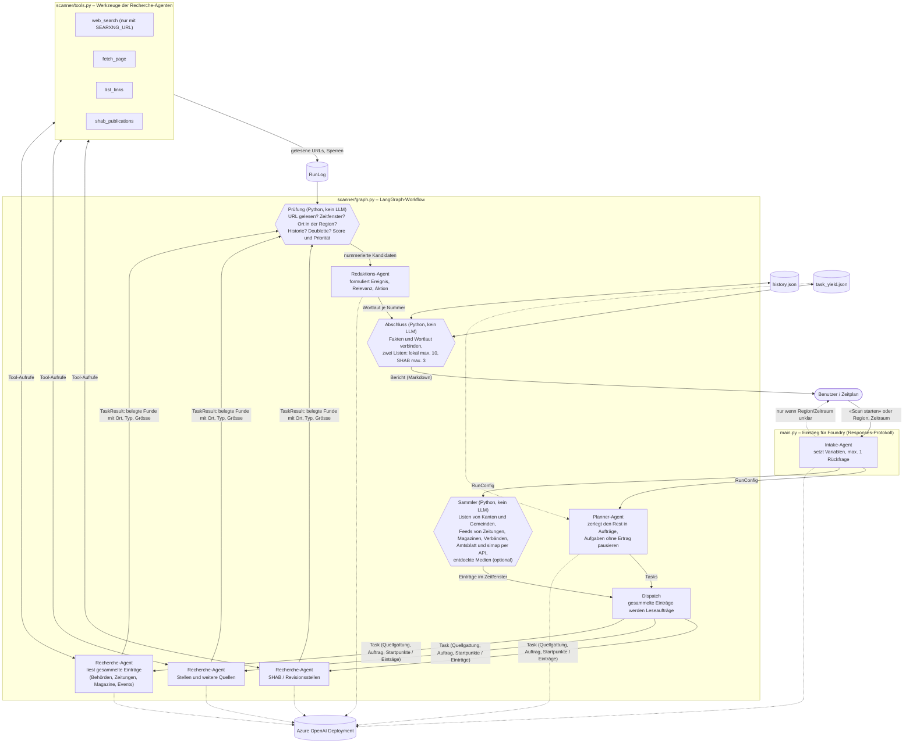

# Medien-Scanner für Akquiseimpulse

Multi-agent sample on **LangChain / LangGraph + Azure OpenAI**. It scans public sources for a
region once a week and turns events into prioritised contact prompts for the branch management.
Local news come first: local media and authorities outrank the commercial register.

It runs in two places with the same code: on your machine (command line), or as a
**Microsoft Foundry hosted agent**. The only cloud dependency is your model deployment.
There is no web front end: a hosted agent is reached through the Foundry Responses protocol, and the
former FastAPI page was only used for local runs and App Service, so it was removed.

## How the agents work together



| Agent | Where | Sees | Hands over |
|---|---|---|---|
| Intake | `main.py` | the chat message | run variables; at most one clarifying question |
| Collector (no LLM) | `collect.py`, `sources.py`, `amtlich.py`, `discover.py` | list pages and feeds of the registered sites, the Amtsblatt and simap APIs, optionally search results of unknown outlets | the entries inside the time window: date, type, source, title, teaser, URL |
| Planner | `graph.py` `plan` | region, time window, the 7 mandatory source categories, which sites are already collected, which task types were unproductive | tasks for everything else; code adds any missing category |
| Research (one per task, in parallel) | `graph.py` `research` | its own task or a batch of collected entries, plus tool results | structured findings with URL, date, quote, **place, event type, size** |
| Check (no LLM) | `report.py`, `scoring.py` | all findings and the network log | numbered candidates with score and priority |
| Editor | `graph.py` `edit` | the candidates, the 8-week history | wording per number: event, relevance, action. No priority, no links |
| Finish (no LLM) | `report.py` | candidates and wording | the final Markdown with two lists |

Design points, borrowed from the [Exa deep-research write-up](https://www.langchain.com/blog/exa):

- **Collect first, then judge.** Known sites are read by plain code: one request per list, one after the other, cached for 3 hours. Agents get the dated entries and open only the ones worth reading; every other page on those sites is closed to them. Before this, agents crawled the sites themselves, guessed URLs and used up the hoster's request limit, which got the run blocked.
- **A request budget per server.** The canton and municipality sites of NW and OW share six servers at one hoster. Measured on 8 October 2026: a server stops answering for about 30 minutes once one client has sent it roughly 30 requests within an hour, whatever the pace. The scanner therefore counts its requests per server across runs (`data/cache/requests.json`) and stops at 20 per hour (`SERVER_BUDGET_PER_HOUR`).
- **Each research agent has its own context.** Only its cleaned, structured result moves on, never its reasoning or raw pages.
- **Structured output everywhere** (`scanner/schemas.py`), so the next step gets data, not prose.
- **The model reads, the code decides.** The researchers state facts and features. Priority, locality, duplicates, the time window and the history are decided in code, so two runs on the same news give the same list. The editor only words the rows; URL, dates, place and priority are taken from the finding, so it cannot invent a row.
- **Budgets.** 18 tool calls per research agent, one request at a time per hosting network, token usage printed per run.

The prompts are in `scanner/prompts.py`.

## Priority and the two lists

The priority is calculated in `scanner/scoring.py`:

```
score = Ereignistyp × Ort × Grösse × Quelle × Aktualität      HOCH ≥ 3.5 · MITTEL ≥ 1.8 · else NIEDRIG
```

| Factor | Set by | Values |
|---|---|---|
| Ereignistyp | researcher picks one of 14 types | 5 succession / M&A and auditor change · 4 management change, investment, anniversary, finance vacancy · 3 tender, new company, restructuring, politics · 2–2.5 event, award · 1 liquidation, other |
| Ort | code, from the place the researcher names | 1.0 first canton of the run (the branch's), 0.9 other canton of the region, 0.6 neighbouring place, outside = dropped |
| Grösse | researcher, from stated figures only | gross 1.3 · mittel 1.0 · klein 0.7 · unbekannt 0.85 |
| Quelle | code, from the URL | local media 1.0 · authorities 0.9 · commercial register (SHAB) 0.6 |
| Aktualität | code, from the publication date | ≤ 3 days 1.0 · inside the window 0.9 · late entry 0.7 |

The numbers are first guesses. If the list feels wrong, change the tables at the top of `scoring.py`; nothing else depends on them.

**Locality is checked in code.** The place must be a known municipality or canton of the region (`GEMEINDEN` in `sources.py`) and, outside the commercial register, it must appear in the finding's own text, so a model cannot just claim it. Cantons without an entry in the registry cannot be checked and pass.

**Two lists** keep the register from crowding out local news: *Lokale Meldungen* (media, authorities, tenders, events, jobs, at most `max_treffer` = 10) and *Handelsregister-Signale (SHAB)* (at most `max_shab` = 3). SHAB notices that never lead to a call are removed before an agent sees them: bankruptcy closed for lack of assets, plain deletions, and liquidations below a capital of CHF 100 000 (`SHAB_MIN_KAPITAL`; unknown capital counts as below). The top recommendation is taken from the best local row, or from the register if there is no local row. Rows that did not make the lists are named under the tables.

## Sources read by the collector

Verified on 13 October 2026; the list lives in `scanner/sources.py`.

| Source | Kind | How it is read |
|---|---|---|
| Kanton Nidwalden, Kanton Obwalden | news, political business, consultations, session and vote dates | embedded list of the municipal web platform |
| 16 municipalities (9 NW, 7 OW) | news | same platform |
| Nidwaldner Zeitung, Obwaldner Zeitung | regional daily papers | RSS feed of the canton section |
| Luzerner Zeitung | business and Central Switzerland sections | RSS, only entries naming the region |
| zentralplus | Central Switzerland online news | RSS (the site answers 403, the feed is open), only entries naming the region |
| ROI – Zentralschweizer Wirtschaftsmagazin | business magazine | RSS, only entries naming the region |
| Bote der Urschweiz | regional paper | news sitemap, only entries naming the region |
| Tele 1 | regional television | weekly sitemap, only entries naming the region |
| unterwalden24 | local online news | sitemap |
| Unterwaldner | local weekly | RSS |
| Nidwaldner Gewerbeverband | trade association | RSS |
| IHZ – Industrie- und Handelskammer Zentralschweiz | event calendar (next 60 days) | HTML list |
| Amtsblatt-Portal NW, OW (`amtsblattportal.ch`) | building applications for larger projects (apartment blocks, hotels, commercial and industrial buildings; heat pumps, carports and the like are left out) | JSON API |
| simap.ch | public tenders for services of authorities in NW and OW | JSON API |

"Naming the region" means the canton or one of its municipalities appears as a whole word in title, teaser or URL.
Sport, culture, lifestyle and opinion sections of the papers are skipped, and a headline carried by several papers is listed once.
Entries from the two APIs carry the label «Direktbeleg»: the API answer is the evidence, an agent does not open them.

Checked and not included: Nidwaldner Blitz and PilatusToday (not reachable on 13 October), IHZ news list (empty), nau.ch (no dated list), Hergiswil and Stansstad (different list layout, left to the planner's tasks).

### Non-configured outlets

Outlets that are not in the registry are found by `scanner/discover.py` **if a search server is configured** (`SEARXNG_URL`, see below): it searches recent news per canton, takes the articles of unknown outlets that name the region and collects them like registered ones. The outlets are listed in the coverage log under «Neu entdeckte Medien»; a regular one belongs into `sources.py`. Without `SEARXNG_URL` discovery is off and the log says so.

Public search sources were tried and dropped: Google News forbids automated clients in its `robots.txt`, GDELT has hardly any Swiss regional papers, and Bing grounding ranks local news poorly. DuckDuckGo scraping (`ddgs`) was removed because it fails randomly. SearXNG is self-hosted and combines several engines; you decide which.

Task types that find nothing are paused: when the planner's tasks for a source type (for example «Stelleninserate») returned no finding in 3 runs in a row, they are skipped and tried again after 28 days. The coverage log lists them under «Übersprungene Rechercheaufträge». The SHAB types are never paused, and the pre-collected entries are always read.

## Run locally

```bash
copy .env.example .env      # then fill in endpoint, deployment, key
uv sync
uv run python -m scanner                       # scheduled-style run with defaults
uv run python -m scanner --dry-run             # test run: nothing is saved (history, statistics, report file)
uv run python -m scanner --region "Kanton Uri" --kantone UR --tage 14 --kontaktentwurf
uv run python -m tests.test_logic              # scoring, locality, register noise, SSRF guard, state files (offline)
uv run python -m tests.test_collect offline    # parsers and access rule (offline); without "offline" also a live collection
uv run python -m tests.smoke_test              # wiring test with a scripted stand-in model, live sources
```

Reports land in `data/reports/`, the 8-week memory in `data/history.json`, the task statistics in `data/task_yield.json`.
Put client names (one per line) in `data/kunden.txt` to fill the «Bestand» column; without it the column says `ungeprüft`. A client matches when its name equals the organisation's or, from 5 characters on, appears in it as whole words.

Optional search server for the agents and for discovery of unknown outlets (enable the JSON format in its `settings.yml` under `search: formats`):

```bash
docker run -d -p 8080:8080 -v ./searxng:/etc/searxng searxng/searxng
# .env: SEARXNG_URL=http://localhost:8080
```

Windows: if the project sits in a very deep folder, imports can fail on the 260-character path limit.
Move it to a short path or set `UV_PROJECT_ENVIRONMENT` to a short folder before `uv sync`.

## Logging and tracing

- **Logging.** Every step writes one JSON line to stderr (`collect_done`, `plan_done`, `research_done` with source type, findings, tool calls and seconds, `pruefen_done` with the scores, `edit_done`, `scan_done` with tokens and blocked sites). A failing research agent is logged with its stack trace under `research_failed`; the run continues.
- **Tracing.** Set `APPLICATIONINSIGHTS_CONNECTION_STRING` and the runs (agents, model calls, tool calls) are sent to Application Insights through the Azure tracer of `langchain-azure-ai`, with one `scan` span holding the totals. Message content is not recorded unless `AZURE_TRACING_GEN_AI_CONTENT_RECORDING_ENABLED=true`. The tracer needs the `opentelemetry` extra of `langchain-azure-ai` (declared in `pyproject.toml`); without it the scan runs and logs `tracing_unavailable`. The Azure tracer is a preview feature of `langchain-azure-ai`. `deploy_foundry.py` passes the variable on to the hosted agent.

## Deploy as a Foundry hosted agent

Based on the [hosted agent quickstart](https://learn.microsoft.com/azure/foundry/agents/quickstarts/quickstart-hosted-agent)
(Python path) and Microsoft's [LangGraph hosted-agent samples](https://github.com/microsoft-foundry/foundry-samples/tree/main/samples/python/hosted-agents/langgraph/responses).
`langgraph.json` points the hosting adapter at `main.py:create_graph`; the adapter serves the
Responses protocol on port 8088.

### Test the hosted entry point locally

```bash
uv run python -m langchain_azure_ai.agents.hosting.run --protocol responses   # terminal 1
uv run python -m tests.call_local_agent "Scan starten"                        # terminal 2
```

### Deploy

```bash
az login --scope "https://ai.azure.com/.default"    # account with "Foundry Project Manager" on the project
uv export --no-hashes --no-dev -o requirements.txt
uv run python deploy_foundry.py
```

`requirements.txt` is generated from `uv.lock`; export it again after every dependency change (Dependabot updates `uv.lock`, not this file).

The script reads the project endpoint and model deployment from `.env`, uploads the code as a new
agent version, waits until it is `active` and routes all traffic to it. Each run creates a new version.
`APPLICATIONINSIGHTS_CONNECTION_STRING`, `SEARXNG_URL`, `SHAB_MIN_KAPITAL` and `MAX_PARALLEL_AGENTS` are passed on if set in `.env`
(the container must be able to reach `SEARXNG_URL`, so `localhost` does not work there).

It uploads only `main.py`, `langgraph.json`, `requirements.txt` and `scanner/` – never `.env`.
In the container the model is reached through the project endpoint with the agent's own identity, no key.
If you deploy with the VS Code Foundry Toolkit or `azd` instead, make sure `.env` is not packaged.

### Talk to the deployed agent

The agent speaks the OpenAI **Responses** protocol at
`https://<resource>.services.ai.azure.com/api/projects/<project>/agents/akquise-scanner`.

**Important:** Foundry cuts a waiting request after about 100 seconds (`424 proxy_timeout`), and a
scan takes 8–12 minutes. Start scans with `background=True` and poll for the result. Short
exchanges, such as the clarifying question, can be called directly.

From the command line:

```bash
uv run python deploy_foundry.py --invoke "Scan starten"
uv run python deploy_foundry.py --invoke "Kanton Uri, letzte 14 Tage, mit Kontaktentwurf"
uv run python deploy_foundry.py --invoke "Testlauf, letzte 3 Tage"
uv run python deploy_foundry.py --resume <response-id>     # fetch a run started earlier
```

From your own Python code (`pip install azure-ai-projects azure-identity`):

```python
import time
from azure.ai.projects import AIProjectClient
from azure.identity import DefaultAzureCredential

project = AIProjectClient(
    endpoint="https://<resource>.services.ai.azure.com/api/projects/<project>",
    credential=DefaultAzureCredential(),          # az login locally, managed identity in Azure
)
agent = project.get_openai_client(agent_name="akquise-scanner").with_options(max_retries=0)

# 1) Start the scan. Returns at once with an id.
run = agent.responses.create(input="Scan starten", background=True)

# 2) Poll until it is done.
while run.status in ("queued", "in_progress"):
    time.sleep(20)
    run = agent.responses.retrieve(run.id)

print(run.output_text)                            # the Markdown report
```

What you can send as `input`:

| Message | What happens |
|---|---|
| `Scan starten` | scheduled-style run with the defaults (Stans, NW/OW, last 7 days) |
| `Kanton Uri, letzte 14 Tage` | region, cantons and period are overridden |
| `… mit Kontaktentwurf` | the top recommendation includes a contact draft |
| `Testlauf …` | nothing is saved (history, statistics) |
| something ambiguous, e.g. `Luzern oder Zug, 14 oder 30 Tage?` | the agent asks one clarifying question and stops |

`max_retries=0` matters: with the client's default retries a timed-out call is sent again and
starts another scan each time.

You can also open the agent in the Foundry portal (Build → Agents → akquise-scanner → Playground);
the same 100-second limit applies there, so use it for short exchanges.

### Things that differ when hosted

- **No persistent disk.** `history.json` and `task_yield.json` are lost when the container is recycled, so the 8-week
  duplicate filter and the pausing of unproductive task types only work within one container lifetime. For production, move both to Blob Storage or a table (`scanner/store.py` is the only place that reads and writes them).
- **Weekly schedule.** Trigger the background call above from a Logic App, an Azure Function timer or a pipeline, and mail `output_text`.
- The container needs outbound internet access to reach the scanned sites.

## Security

- **Outgoing requests only reach public web servers.** URLs come from web pages and feeds, so a manipulated page could point an agent at an internal address. `scanner/netsafe.py` blocks private, loopback and link-local addresses (including the cloud metadata service), ports other than 80 and 443, and redirects to such targets. The search server in `SEARXNG_URL` is set by the operator and is exempt.
- No inbound interface besides the Foundry Responses endpoint, which Foundry protects with Entra ID. The former FastAPI page had no login and is gone.
- `robots.txt`, 401/403/429 and paywalls are respected and logged, not bypassed. Tool results are treated as data, not instructions.
- Secrets stay in `.env` (ignored by git) or in the agent's managed identity.

## Limits worth knowing

- **No headless browser.** Pages that need JavaScript or a login are not read.
- When a server's hourly budget is used up, or a server stops answering, the affected sites are listed under «Nicht erreichbar» with the reason. A later run within 3 hours reuses the lists already read and continues from there.
- `robots.txt` of the registered sites is kept for half a year and refreshed for one site per run, to save requests. Its rules apply once known.
- The source registry (`scanner/sources.py`) covers NW and OW. Other cantons skip the registry sources and the locality check, and are researched by the agents alone (plus the two APIs) until their sites are added.
- **Newspapers behind a paywall.** If an article cannot be read, the scanner uses only what the publisher's own feed gives to everyone: title, date and teaser. The agent is told to state nothing beyond that, and the coverage log says «Paywall: nur Titel und Anriss gelesen». Remove the teaser fallback in `tools.py` if you want paywalled articles left out entirely.
- A newspaper feed holds roughly the last week of articles. Older articles inside the 14-day late-entry window are not collected.
- **No anniversary detection from the register.** The public Zefix interface needs credentials, and open data sources checked on 13 October (LINDAS, Wikidata) did not give founding dates for NW and OW companies. Anniversaries are only found when a paper or an authority reports them.
- **No systematic job source.** LinkedIn (`robots.txt`) and Indeed (HTTP 403) are closed to automated clients. jobs.ch and jobscout24 could be read in test runs, but only through the start points the planner picks, so vacancies are found by chance rather than collected. Vacancies of the authorities appear in their news.
- Not collected yet: event calendars of the municipalities and the canton (mostly non-business events).

## Project structure

| Path | Purpose |
|---|---|
| `main.py`, `langgraph.json` | entry point of the Foundry hosted agent (intake agent, then the scan) |
| `deploy_foundry.py` | uploads the code as a hosted agent version, invokes and resumes runs |
| `scanner/__main__.py` | command line |
| `scanner/graph.py` | the LangGraph workflow: collect, plan, dispatch, research, check, edit, finish |
| `scanner/collect.py`, `parsers.py`, `sources.py` | collector, list parsers (municipal platform, RSS/Atom, sitemap, IHZ), source registry and place lists |
| `scanner/amtlich.py`, `discover.py` | Amtsblatt and simap APIs, discovery of unknown outlets |
| `scanner/tools.py`, `netsafe.py`, `cache.py` | agent tools, polite HTTP access with SSRF guard, on-disk cache and request ledger |
| `scanner/schemas.py`, `prompts.py` | structured outputs and prompts |
| `scanner/scoring.py`, `report.py` | priority tables and locality check, checks, lists, Markdown |
| `scanner/store.py` | history and task statistics (atomic, locked writes) |
| `scanner/telemetry.py`, `llm.py`, `config.py` | logging and tracing, model client, run variables |
| `tests/` | offline logic tests, collector tests, wiring test, helpers for the hosted entry point |
| `.github/dependabot.yml` | weekly dependency updates |

## Dependency updates

Dependabot (`.github/dependabot.yml`) opens a pull request per week for `uv.lock`, grouped into Azure/OpenTelemetry packages, LangChain/LangGraph packages and other minor and patch updates.
Review it like any change: run the tests, then `uv export --no-hashes --no-dev -o requirements.txt` before the next deployment.
