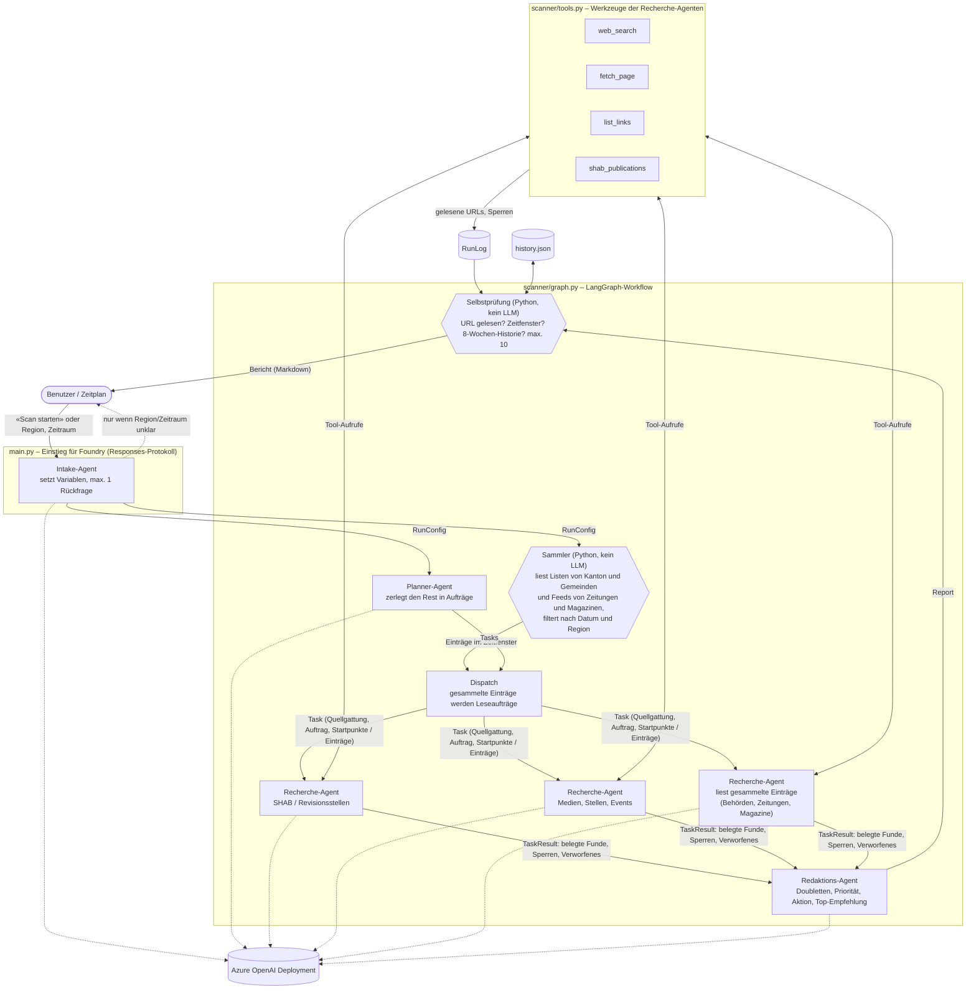

# Medien-Scanner für Akquiseimpulse

Multi-agent sample on **LangChain / LangGraph + Azure OpenAI**. It scans public sources for a
region once a week and turns events into prioritised contact prompts for the branch management.

It runs in three places with the same code: on your machine, on Azure App Service, or as a
**Microsoft Foundry hosted agent**. The only cloud dependency is your model deployment.

## How the agents work together



| Agent | Where | Sees | Hands over |
|---|---|---|---|
| Intake | `main.py` | the chat message | run variables; at most one clarifying question |
| Collector (no LLM) | `collect.py`, `sources.py` | the list pages of all registered canton and municipality sites, and the feeds of the registered newspapers and magazines | the entries inside the time window: date, type, source, title, teaser, URL |
| Planner | `graph.py` `plan` | region, time window, the 7 mandatory source categories, which sites are already collected | tasks for everything else; code adds any missing category |
| Research (one per task, in parallel) | `graph.py` `research` | its own task or a batch of collected entries, plus tool results | structured findings with URL, date and quote |
| Editor | `graph.py` `edit` | all findings, the 8-week history | report rows, priorities, top recommendation |
| Self-check | `report.py` | editor output and the network log | the final Markdown |

Design points, borrowed from the [Exa deep-research write-up](https://www.langchain.com/blog/exa):

- **Collect first, then judge.** Known sites are read by plain code: one request per list, one after the other, cached for 3 hours. Agents get the dated entries and open only the ones worth reading; every other page on those sites is closed to them. Before this, agents crawled the sites themselves, guessed URLs and used up the hoster's request limit, which got the run blocked.
- **A request budget per server.** The canton and municipality sites of NW and OW share six servers at one hoster. Measured on 8 October 2026: a server stops answering for about 30 minutes once one client has sent it roughly 30 requests within an hour, whatever the pace. The scanner therefore counts its requests per server across runs (`data/cache/requests.json`) and stops at 20 per hour (`SERVER_BUDGET_PER_HOUR`).
- **Each research agent has its own context.** Only its cleaned, structured result moves on, never its reasoning or raw pages.
- **Structured output everywhere** (`scanner/schemas.py`), so the next step gets data, not prose.
- **Hard rules are code, not prompt.** A row is dropped if its URL was not actually read in this run, if the date is outside the window, or if it was reported in the last 8 weeks.
- **Budgets.** 18 tool calls per research agent, one request at a time per hosting network, token usage printed per run.

The prompts are in `scanner/prompts.py`.

## Sources read by the collector

Verified on 8 October 2026; the list lives in `scanner/sources.py`.

| Source | Kind | How it is read |
|---|---|---|
| Kanton Nidwalden, Kanton Obwalden | news, political business, consultations, session and vote dates | embedded list of the municipal web platform |
| 16 municipalities (9 NW, 7 OW) | news | same platform |
| Nidwaldner Zeitung, Obwaldner Zeitung | regional daily papers | RSS feed of the canton section |
| Luzerner Zeitung, Wirtschaft | business section of the regional paper | RSS, only entries naming the region |
| ROI – Zentralschweizer Wirtschaftsmagazin | business magazine | RSS, only entries naming the region |
| Bote der Urschweiz | regional paper | news sitemap, only entries naming the region |
| Tele 1 | regional television | weekly sitemap, only entries naming the region |
| unterwalden24 | local online news | sitemap |
| Unterwaldner | local weekly | RSS |
| Nidwaldner Gewerbeverband | trade association | RSS |

"Naming the region" means the canton or one of its municipalities appears as a whole word in title, teaser or URL.
Sport, culture, lifestyle and opinion sections of the papers are skipped, and a headline carried by several papers is listed once.

Checked and not included: zentralplus (answers 403 to automated clients), PilatusToday (not reachable), Nidwaldner Blitz (events only, no article list), IHZ (empty news list), nau.ch (no dated list).
The planner is told to look for further regional publications beyond this list, so the agents still search for them.

## Run locally

```bash
copy .env.example .env      # then fill in endpoint, deployment, key
uv sync
uv run python -m scanner                       # scheduled-style run with defaults
uv run python -m scanner --region "Kanton Uri" --kantone UR --tage 14 --kontaktentwurf
uv run uvicorn scanner.api:app --port 8000     # web page on http://localhost:8000
uv run python -m tests.smoke_test              # wiring test without a model
uv run python -m tests.test_collect            # collector: parser, access rule, live collection
```

Reports land in `data/reports/`, the 8-week memory in `data/history.json`.
Put client names (one per line) in `data/kunden.txt` to fill the «Bestand» column; without it the column says `ungeprüft`.

Windows: if the project sits in a very deep folder, imports can fail on the 260-character path limit.
Move it to a short path or set `UV_PROJECT_ENVIRONMENT` to a short folder before `uv sync`.

## Deploy as a Foundry hosted agent

Based on the [hosted agent quickstart](https://learn.microsoft.com/azure/foundry/agents/quickstarts/quickstart-hosted-agent)
(Python path) and Microsoft's [LangGraph hosted-agent samples](https://github.com/microsoft-foundry/foundry-samples/tree/main/samples/python/hosted-agents/langgraph/responses).
`langgraph.json` points the hosting adapter at `main.py:create_graph`; the adapter serves the
Responses protocol on port 8088.

### Test the hosted entry point locally

```bash
uv run python -m langchain_azure_ai.agents.hosting.run --protocol responses   # terminal 1
uv run python -m tests.call_local_agent "Scan starten"                        # terminal 2
```

### Deploy

```bash
az login --scope "https://ai.azure.com/.default"    # account with "Foundry Project Manager" on the project
uv export --no-hashes --no-dev -o requirements.txt
uv run python deploy_foundry.py
```

The script reads the project endpoint and model deployment from `.env`, uploads the code as a new
agent version, waits until it is `active` and routes all traffic to it. Each run creates a new version.

It uploads only `main.py`, `langgraph.json`, `requirements.txt` and `scanner/` – never `.env`.
In the container the model is reached through the project endpoint with the agent's own identity, no key.
If you deploy with the VS Code Foundry Toolkit or `azd` instead, make sure `.env` is not packaged.

### Talk to the deployed agent

The agent speaks the OpenAI **Responses** protocol at
`https://<resource>.services.ai.azure.com/api/projects/<project>/agents/akquise-scanner`.

**Important:** Foundry cuts a waiting request after about 100 seconds (`424 proxy_timeout`), and a
scan takes 8–12 minutes. Start scans with `background=True` and poll for the result. Short
exchanges, such as the clarifying question, can be called directly.

From the command line:

```bash
uv run python deploy_foundry.py --invoke "Scan starten"
uv run python deploy_foundry.py --invoke "Kanton Uri, letzte 14 Tage, mit Kontaktentwurf"
uv run python deploy_foundry.py --resume <response-id>     # fetch a run started earlier
```

From your own Python code (`pip install azure-ai-projects azure-identity`):

```python
import time
from azure.ai.projects import AIProjectClient
from azure.identity import DefaultAzureCredential

project = AIProjectClient(
    endpoint="https://<resource>.services.ai.azure.com/api/projects/<project>",
    credential=DefaultAzureCredential(),          # az login locally, managed identity in Azure
)
agent = project.get_openai_client(agent_name="akquise-scanner").with_options(max_retries=0)

# 1) Start the scan. Returns at once with an id.
run = agent.responses.create(input="Scan starten", background=True)

# 2) Poll until it is done.
while run.status in ("queued", "in_progress"):
    time.sleep(20)
    run = agent.responses.retrieve(run.id)

print(run.output_text)                            # the Markdown report
```

What you can send as `input`:

| Message | What happens |
|---|---|
| `Scan starten` | scheduled-style run with the defaults (Stans, NW/OW, last 7 days) |
| `Kanton Uri, letzte 14 Tage` | region, cantons and period are overridden |
| `… mit Kontaktentwurf` | the top recommendation includes a contact draft |
| something ambiguous, e.g. `Luzern oder Zug, 14 oder 30 Tage?` | the agent asks one clarifying question and stops |

`max_retries=0` matters: with the client's default retries a timed-out call is sent again and
starts another scan each time.

You can also open the agent in the Foundry portal (Build → Agents → akquise-scanner → Playground);
the same 100-second limit applies there, so use it for short exchanges.

### Things that differ when hosted

- **No persistent disk.** `history.json` is lost when the container is recycled, so the 8-week
  duplicate filter only works within one container lifetime. For production, move the history to Blob Storage or a table.
- **Weekly schedule.** Trigger the background call above from a Logic App, an Azure Function timer or a pipeline, and mail `output_text`.
- The container needs outbound internet access to reach the scanned sites.
## Deploy on Azure App Service (Linux, Python 3.13)

```bash
uv export --no-hashes --no-dev -o requirements.txt
az webapp up --name <app-name> --runtime PYTHON:3.13 --sku B1
az webapp config set --name <app-name> --startup-file "python -m uvicorn scanner.api:app --host 0.0.0.0 --port 8000"
az webapp config appsettings set --name <app-name> --settings AZURE_OPENAI_ENDPOINT=... AZURE_OPENAI_DEPLOYMENT=... DATA_DIR=/home/data
```

- Without a key: enable the app's managed identity, grant it *Cognitive Services OpenAI User*, leave `AZURE_OPENAI_API_KEY` unset.
- The web page has no login. Switch on App Service Authentication (Entra ID) before exposing it.
- Weekly run: a scheduled WebJob that calls `python -m scanner`.

## Limits worth knowing

- **Search** uses DuckDuckGo through the `ddgs` library (no account). For a fully self-hosted setup run SearXNG and set `SEARXNG_URL`.
- **No headless browser.** Pages that need JavaScript or a login are not read.
- `robots.txt`, 401/403/429 and paywalls are respected and logged, not bypassed.
- When a server's hourly budget is used up, or a server stops answering, the affected sites are listed under «Nicht erreichbar» with the reason. A later run within 3 hours reuses the lists already read and continues from there.
- `robots.txt` of the registered sites is kept for half a year and refreshed for one site per run, to save requests. Its rules apply once known.
- The source registry (`scanner/sources.py`) covers NW and OW. Other cantons skip the collector and are researched by the agents alone until their sites are added. Hergiswil and Stansstad use a different list layout and are not collected.
- **Newspapers behind a paywall.** If an article cannot be read, the scanner uses only what the publisher's own feed gives to everyone: title, date and teaser. The agent is told to state nothing beyond that, and the coverage log says «Paywall: nur Titel und Anriss gelesen». Remove the teaser fallback in `tools.py` if you want paywalled articles left out entirely.
- A newspaper feed holds roughly the last week of articles. Older articles inside the 14-day late-entry window are not collected.
- Not collected yet: event calendars and building applications.
